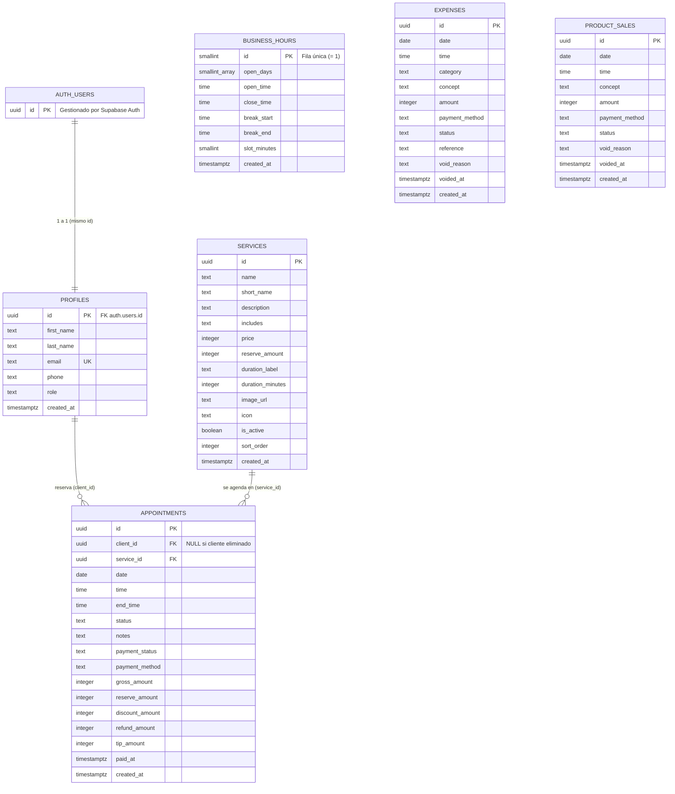

# Modelo de datos · JM Barber Studio

> Diseño del modelo de datos del MVP para **Supabase (PostgreSQL + Auth + RLS)**, alineado con `docs/producto.md`, `docs/arquitectura.md` y las especificaciones `docs/specs/F1..F5`.
> Convenciones: moneda en pesos colombianos sin decimales (**COP**, enteros `integer`), zona horaria del estudio **`America/Bogota`**, barbería operada por **un solo barbero** en el MVP.

---

## 1. Diagrama Entidad–Relación (ER)

> **Notas estructurales:**
> - `business_hours` es una tabla de configuración global de **una sola fila** (`id = 1`); no tiene clave foránea hacia `appointments`, pero gobierna las fechas abiertas, el paso de la agenda (`slot_minutes`), la jornada laboral y la pausa de almuerzo que el servidor valida al reservar.
> - Las franjas disponibles **no se guardan** como tabla: se calculan dinámicamente combinando `business_hours`, la duración del servicio elegido (`services.duration_minutes`) y los rangos horarios ya ocupados en `appointments` (`[time, end_time)`).
> - `expenses` y `product_sales` son entidades contables independientes gestionadas exclusivamente por `admin`; junto con las citas cobradas (`appointments`), alimentan el reporte de ganancias y el cierre de caja diario (spec F5).

---

## 2. Entidades y campos

### 2.1 `profiles` (Perfiles de usuario)
Extiende `auth.users` con los datos de negocio y el rol real del usuario. Se crea automáticamente al registrarse y siempre nace con `role = 'cliente'`.

| Campo | Tipo de Postgres | ¿Nulo? | Regla |
|---|---|---|---|
| `id` | `uuid` | No | Clave primaria; igual a `auth.users.id` (FK con borrado en cascada) |
| `first_name` | `text` | No | Obligatorio; no puede ser vacío ni solo espacios |
| `last_name` | `text` | No | Por defecto cadena vacía `''` |
| `email` | `text` | No | Único sin distinguir mayúsculas/minúsculas (`lower(email)`); formato de correo válido |
| `phone` | `text` | Sí | Teléfono opcional (formato Colombia `+57 ...`) |
| `role` | `text` | No | Por defecto `'cliente'`; valores permitidos: `'cliente'`, `'barbero'`, `'admin'` |
| `created_at` | `timestamptz` | No | Por defecto fecha/hora actual UTC |

### 2.2 `services` (Catálogo de servicios)
Servicios ofrecidos por la barbería con su precio, duración real y reserva fija para gastos del negocio. Se desactivan lógicamente (`is_active = false`); no se eliminan físicamente si tienen citas históricas.

| Campo | Tipo de Postgres | ¿Nulo? | Regla |
|---|---|---|---|
| `id` | `uuid` | No | Clave primaria generada automáticamente |
| `name` | `text` | No | Nombre completo del servicio; no vacío |
| `short_name` | `text` | No | Nombre corto para tarjetas y botones; no vacío |
| `description` | `text` | No | Descripción visible en el catálogo |
| `includes` | `text` | Sí | Detalle opcional de lo que incluye el servicio |
| `price` | `integer` | No | Precio en COP sin decimales; mayor a `0` |
| `reserve_amount` | `integer` | No | Monto fijo en COP que se aparta para gastos; por defecto `0`; entre `0` y `price` |
| `duration_label` | `text` | No | Etiqueta legible de duración (ej. `"60 min"`, `"30 min"`); no vacía |
| `duration_minutes` | `integer` | No | Duración real en minutos usada para calcular `appointments.end_time`; por defecto `30`; mayor a `0` |
| `image_url` | `text` | Sí | Ruta local o URL de imagen del servicio |
| `icon` | `text` | No | Nombre del ícono Material Symbols; por defecto `'content_cut'` |
| `is_active` | `boolean` | No | Por defecto `true`; solo los activos se muestran en `/` y `/cliente` |
| `sort_order` | `integer` | No | Orden de visualización; por defecto `0`; mayor o igual a `0` |
| `created_at` | `timestamptz` | No | Por defecto fecha/hora actual UTC |

### 2.3 `business_hours` (Horario de atención)
Configuración única de días laborables, apertura, cierre, pausa de almuerzo y paso base de la agenda.

| Campo | Tipo de Postgres | ¿Nulo? | Regla |
|---|---|---|---|
| `id` | `smallint` | No | Clave primaria; valor único obligatorio `1` |
| `open_days` | `smallint[]` | No | Días abiertos (`0` = domingo … `6` = sábado); por defecto `{1,2,3,4,5,6}`; todos los valores entre `0` y `6` |
| `open_time` | `time` | No | Hora de apertura; por defecto `'09:00'`; menor que `close_time` |
| `close_time` | `time` | No | Hora de cierre; por defecto `'20:00'`; mayor que `open_time` |
| `break_start` | `time` | Sí | Inicio de pausa de almuerzo (por defecto `'14:00'`); nulo solo si `break_end` también es nulo |
| `break_end` | `time` | Sí | Fin de pausa de almuerzo (por defecto `'15:00'`); si existe, debe cumplirse `open_time <= break_start < break_end <= close_time` |
| `slot_minutes` | `smallint` | No | Paso de inicio entre turnos en minutos (ej. `15` o `30`); por defecto `30`; valores permitidos mayores a `0` (ej. `15`, `30`, `45`, `60`) |
| `created_at` | `timestamptz` | No | Por defecto fecha/hora actual UTC |

### 2.4 `appointments` (Citas e ingreso por servicio)
Cada fila representa una reserva con su rango horario congelado (`[time, end_time)`) y, al completarse, su registro financiero congelado (`gross_amount`, `reserve_amount`, ajustes y propina).

| Campo | Tipo de Postgres | ¿Nulo? | Regla |
|---|---|---|---|
| `id` | `uuid` | No | Clave primaria generada automáticamente |
| `client_id` | `uuid` | Sí | FK a `profiles.id` (`ON DELETE SET NULL`); obligatorio al crear desde el servidor (`auth.uid()`); solo pasa a `NULL` si el cliente es eliminado posteriormente |
| `service_id` | `uuid` | No | FK a `services.id` (`ON DELETE RESTRICT`) |
| `date` | `date` | No | Fecha de la cita (zona horaria `America/Bogota`) |
| `time` | `time` | No | Hora de inicio del turno (`HH:MM`) |
| `end_time` | `time` | No | Hora de fin congelada al reservar (`time + services.duration_minutes`); siempre mayor que `time` |
| `status` | `text` | No | Por defecto `'confirmada'`; valores: `'pendiente'`, `'confirmada'`, `'en_curso'`, `'completada'`, `'cancelada'` |
| `notes` | `text` | Sí | Notas opcionales del cliente o del estudio |
| `payment_status` | `text` | No | Por defecto `'pendiente'`; valores: `'pendiente'`, `'pagado'`, `'reembolsado'`, `'anulado'` |
| `payment_method` | `text` | Sí | Nulo hasta completarla; valores: `'efectivo'`, `'transferencia'`, `'tarjeta'`, `'nequi_daviplata'` |
| `gross_amount` | `integer` | Sí | Precio del servicio en COP congelado al completarla; nulo o mayor a `0` |
| `reserve_amount` | `integer` | Sí | Reserva fija en COP congelada al completarla; nulo o entre `0` y `gross_amount` |
| `discount_amount` | `integer` | No | Descuento en COP; por defecto `0`; mayor o igual a `0` |
| `refund_amount` | `integer` | No | Reembolso en COP; por defecto `0`; mayor o igual a `0`; `discount_amount + refund_amount <= gross_amount` |
| `tip_amount` | `integer` | No | Propina en COP (se reporta aparte de ingresos y reserva); por defecto `0`; mayor o igual a `0` |
| `paid_at` | `timestamptz` | Sí | Fecha/hora en que se registró el cobro |
| `created_at` | `timestamptz` | No | Por defecto fecha/hora actual UTC |

### 2.5 `expenses` (Gastos operativos)
Egresos del estudio cubiertos con la reserva del negocio. Un gasto registrado puede editarse, anularse con motivo o eliminarse; un gasto anulado queda inmutable (solo puede eliminarse definitivamente).

| Campo | Tipo de Postgres | ¿Nulo? | Regla |
|---|---|---|---|
| `id` | `uuid` | No | Clave primaria generada automáticamente |
| `date` | `date` | No | Fecha del gasto |
| `time` | `time` | No | Hora del gasto; por defecto `'12:00'` |
| `category` | `text` | No | Valores: `'arriendo'`, `'servicios_publicos'`, `'nomina_administrativa'`, `'insumos_generales'`, `'compra_insumos_productos'`, `'publicidad'`, `'mantenimiento'`, `'otros'` |
| `concept` | `text` | No | Concepto descriptivo; no vacío |
| `amount` | `integer` | No | Importe en COP sin decimales; mayor a `0` |
| `payment_method` | `text` | No | Por defecto `'transferencia'`; valores: `'efectivo'`, `'transferencia'`, `'tarjeta'`, `'nequi_daviplata'` |
| `status` | `text` | No | Por defecto `'registrado'`; valores: `'registrado'`, `'anulado'` |
| `reference` | `text` | Sí | Número de comprobante o factura opcional |
| `void_reason` | `text` | Sí | Obligatorio y no vacío si `status = 'anulado'`; nulo si `status = 'registrado'` |
| `voided_at` | `timestamptz` | Sí | Obligatorio si `status = 'anulado'`; nulo si `status = 'registrado'` |
| `created_at` | `timestamptz` | No | Por defecto fecha/hora actual UTC |

### 2.6 `product_sales` (Ventas de productos)
Ventas directas de productos en la barbería. Suman a **Ingresos** y **Tu ganancia**, no apartan reserva y no afectan el ticket promedio de servicios.

| Campo | Tipo de Postgres | ¿Nulo? | Regla |
|---|---|---|---|
| `id` | `uuid` | No | Clave primaria generada automáticamente |
| `date` | `date` | No | Fecha de la venta |
| `time` | `time` | No | Hora de la venta; por defecto `'12:00'` |
| `concept` | `text` | No | Producto o descripción de la venta; no vacío |
| `amount` | `integer` | No | Monto en COP sin decimales; mayor a `0` |
| `payment_method` | `text` | No | Por defecto `'efectivo'`; valores: `'efectivo'`, `'transferencia'`, `'tarjeta'`, `'nequi_daviplata'` |
| `status` | `text` | No | Por defecto `'registrado'`; valores: `'registrado'`, `'anulado'` |
| `void_reason` | `text` | Sí | Obligatorio y no vacío si `status = 'anulado'`; nulo si `status = 'registrado'` |
| `voided_at` | `timestamptz` | Sí | Obligatorio si `status = 'anulado'`; nulo si `status = 'registrado'` |
| `created_at` | `timestamptz` | No | Por defecto fecha/hora actual UTC |

---

## 3. Restricciones de base de datos

### 3.1 Claves foráneas (Foreign Keys)
| Tabla.columna | Referencia | Acción al eliminar | Motivo |
|---|---|---|---|
| `profiles.id` | `auth.users.id` | `ON DELETE CASCADE` | Al eliminar una cuenta en Supabase Auth se elimina su perfil automáticamente |
| `appointments.client_id` | `profiles.id` | `ON DELETE SET NULL` | Permite eliminar un usuario sin borrar citas pasadas ni descuadrar la contabilidad histórica (se muestra como *"Cliente eliminado"*) |
| `appointments.service_id` | `services.id` | `ON DELETE RESTRICT` | Impide borrar físicamente un servicio que tiene citas asociadas; se usa desactivación lógica (`is_active = false`) |

### 3.2 Restricciones `UNIQUE` y de no solapamiento
| Tabla | Columnas / rango | Condición | Propósito |
|---|---|---|---|
| `profiles` | `lower(email)` (índice `UNIQUE`) | Todas las filas | Impide dos perfiles con el mismo correo sin importar mayúsculas/minúsculas |
| `appointments` | `(date, time)` (índice `UNIQUE` parcial) | Donde `status <> 'cancelada'` | Impide dos citas activas/completadas con la misma hora de inicio |
| `appointments` | `(date, rango [time, end_time))` (restricción `EXCLUDE` con `btree_gist`) | Donde `status <> 'cancelada'` | Impide que dos citas no canceladas se solapen en el tiempo (ej. Corte `09:00–10:00` y Barba `09:30–10:00`) |

### 3.3 Restricciones `CHECK`
| Tabla | Restricción | Regla verificada |
|---|---|---|
| `profiles` | Rol y nombre válidos | `role` en `('cliente','barbero','admin')`; `first_name` no vacío tras quitar espacios |
| `services` | Precio, reserva, duración y orden | `price > 0`, `duration_minutes > 0`, `sort_order >= 0`, `reserve_amount >= 0`, `reserve_amount <= price`, `name`/`short_name`/`duration_label` no vacíos |
| `business_hours` | Fila única y coherencia horaria | `id = 1`, `slot_minutes > 0`, `open_time < close_time`, todos los valores de `open_days` entre `0` y `6`, y pausa nula por completo o cumpliendo `open_time <= break_start < break_end <= close_time` |
| `appointments` | Rango horario, estados y montos | `end_time > time`; `status`, `payment_status` y `payment_method` en sus enumeraciones; `gross_amount > 0` (si no nulo); `reserve_amount`, `discount_amount`, `refund_amount`, `tip_amount >= 0`; `reserve_amount <= gross_amount` (si no nulos); `discount_amount + refund_amount <= gross_amount` (cuando hay `gross_amount`) |
| `expenses` | Categoría, método, monto y anulación | `category`, `payment_method` y `status` válidos; `concept` no vacío; `amount > 0`; si `status = 'anulado'` exige `void_reason` no vacío y `voided_at` no nulo (y ambos nulos si `status = 'registrado'`) |
| `product_sales` | Método, monto y anulación | `payment_method` y `status` válidos; `concept` no vacío; `amount > 0`; si `status = 'anulado'` exige `void_reason` no vacío y `voided_at` no nulo (y ambos nulos si `status = 'registrado'`) |

---

## 4. Reglas de negocio por capa

| # | Regla de negocio ("qué NO puede pasar nunca") | Capa | Cómo se garantiza |
|---|---|---|---|
| 1 | No puede haber dos citas no canceladas que se crucen o solapen en la misma fecha (ni con el mismo inicio ni parcialmente) | **BD + Servidor** | Índice `UNIQUE` parcial `(date, time)` + restricción `EXCLUDE` de no solapamiento sobre `[time, end_time)` donde `status <> 'cancelada'`; el servidor traduce conflicto de BD (`23505` / `23P01`) a HTTP `409` |
| 2 | No se puede reservar en una fecha u hora que ya pasó (hora `America/Bogota`) | **Servidor** | Validación con reloj de Colombia antes de insertar (`400`); el front además oculta los turnos pasados de hoy |
| 3 | Solo se puede reservar un servicio activo, en un día abierto, iniciando en un múltiplo de `slot_minutes` desde `open_time`, y cuyo rango completo `[time, end_time)` quepa antes de `close_time` y sin cruzar la pausa de almuerzo (`[break_start, break_end)`) | **Servidor** | Validación contra `services` y `business_hours` antes de insertar (`400` / `404`); `end_time` siempre lo calcula el servidor desde `services.duration_minutes` (nunca se acepta del cliente) |
| 4 | Cambiar la duración o el precio/reserva de un servicio no altera citas ya agendadas ni la contabilidad histórica | **Servidor + BD** | Al reservar se congela `end_time`; al completar la cita se congelan `gross_amount` y `reserve_amount` en `appointments` |
| 5 | Un cliente puede tener varias citas activas en horarios distintos; `NextAppointmentCard` le muestra la más cercana | **Servidor** | Sin límite artificial de una cita por cliente; consulta ordenada por `(date, time)` filtrando citas futuras activas |
| 6 | Un cliente solo ve sus propias citas y nunca ve datos de otros clientes al consultar disponibilidad | **BD (RLS)** | RLS en `appointments` (`client_id = auth.uid()`). La disponibilidad usa una función controlada (`get_booked_ranges(fecha)` / `get_booked_slots`) que devuelve solo rangos horarios ocupados sin nombres ni IDs |
| 7 | Un cliente solo puede cancelar sus citas activas (`pendiente` o `confirmada`); nunca puede marcarlas `completada`, cambiar fecha/hora ni alterar campos de pago | **BD + Servidor** | El servidor valida rol/dueño/estado (`403` / `409`) y en BD se impide cualquier edición del cliente que no sea cancelar su propia cita activa (política RLS + trigger o función dedicada de cancelación) |
| 8 | Solo el `admin` puede revertir una cita ya `completada`; el `barbero` no puede deshacer un cobro ya registrado | **BD + Servidor** | El servidor rechaza (`403`) que un `barbero` modifique una cita cuyo estado actual es `'completada'`; reforzado en BD con trigger/validación de transición |
| 9 | Al reactivar una cita `cancelada` (solo `admin`/`barbero`), no puede chocar con un turno ya ocupado | **BD + Servidor** | La restricción de unicidad y no solapamiento en `appointments` bloquea la reactivación si el rango ya está tomado y el servidor responde `409` |
| 10 | Solo el `admin` puede ajustar el pago (método, descuento, reembolso, propina) y únicamente sobre una cita `completada` | **BD + Servidor** | Validación de rol `admin` y `status = 'completada'` en servidor (`403` / `409`), más RLS/trigger en BD |
| 11 | `discount_amount + refund_amount` nunca superan `gross_amount`, y ningún monto (descuento, reembolso, propina, reserva) puede ser negativo | **BD + Servidor** | Restricciones `CHECK` en `appointments` + validación Zod en servidor (`400`) |
| 12 | `reserve_amount` de un servicio nunca es negativo ni supera `price`, y `price`/`duration_minutes` son mayores a `0` | **BD + Servidor** | Restricciones `CHECK` en `services` + validación en servidor (`400`) |
| 13 | Un gasto o venta de producto siempre tiene `amount > 0`; anular exige motivo obligatorio; una vez `anulado` queda congelado (no se edita ni se vuelve a anular) | **BD + Servidor** | `CHECK` de monto y de `void_reason`/`voided_at` en BD; bloqueo de edición de filas `anulado` en servidor (`409`) y en BD (trigger / filtro `status = 'registrado'`) |
| 14 | El `barbero` solo accede a la agenda y ve únicamente nombre y apellido del cliente (nunca correo ni teléfono ni datos contables) | **BD (RLS) + Servidor** | `barbero` no tiene permiso `SELECT` en `profiles`, `expenses` ni `product_sales`; obtiene solo `(id, first_name, last_name)` mediante `get_client_names(ids)` y el proxy/servidor bloquean rutas exclusivas de `admin` |
| 15 | Todo registro nuevo nace como `cliente`, nadie puede cambiar su propio `role`, y el `admin` nunca puede eliminarse ni quitarse el rol `admin` | **BD + Servidor** | Trigger de registro fuerza `role = 'cliente'`; política RLS de `profiles` exige `role = get_my_role()` en auto-edición; `delete_user` (BD) y la acción de usuarios (servidor + trigger) bloquean auto-eliminación y auto-degradación |
| 16 | Eliminar un usuario no descuadra la contabilidad ni deja turnos futuros bloqueados | **BD** | La función `delete_user(id)` (solo `admin`) primero cancela las citas futuras activas del usuario y luego elimina su cuenta en `auth.users`; la FK `ON DELETE SET NULL` conserva las citas históricas con `client_id = NULL` |
| 17 | No se puede eliminar físicamente un servicio que tenga citas asociadas | **BD + Servidor** | FK `ON DELETE RESTRICT` en `appointments.service_id`; en la app solo se alterna `is_active` |

---

## 5. Dueño de cada fila y reglas de acceso (base para RLS)

| Tabla | Dueño de la fila | Lectura (`SELECT`) | Creación (`INSERT`) | Actualización (`UPDATE`) | Eliminación (`DELETE`) |
|---|---|---|---|---|---|
| `profiles` | El propio usuario (`id = auth.uid()`) | Propio usuario; `admin` todos (`barbero` **no** lee esta tabla: usa `get_client_names`) | Solo trigger automático desde `auth.users` (rol forzado `'cliente'`) | Propio usuario (sin cambiar `role`); `admin` cualquiera (sin quitarse su propio rol `admin`) | Solo `admin` mediante función `delete_user(id)` (nunca a sí mismo) |
| `services` | El negocio (`admin`) | Público (anónimo y autenticados) si `is_active = true`; `admin` todos | Solo `admin` | Solo `admin` | Nadie en operación normal (desactivación lógica; `ON DELETE RESTRICT`) |
| `business_hours` | El negocio (`admin`) | Público (anónimo y autenticados) | Solo semilla inicial (`id = 1`) | Solo `admin` | Nadie (fila única obligatoria) |
| `appointments` | El cliente (`client_id = auth.uid()`) | Cliente dueño (`client_id = auth.uid()`); `admin` y `barbero` todas. (Disponibilidad autenticada solo vía función de rangos ocupados) | Cualquier usuario autenticado únicamente para sí mismo (`client_id = auth.uid()`) | Cliente: solo cancelar sus citas activas; `barbero`: cambiar estado de citas no completadas; `admin`: cualquier estado y ajuste de pago | Nadie en operación normal (las citas se cancelan, no se borran) |
| `expenses` | El negocio (`admin`) | Solo `admin` | Solo `admin` | Solo `admin` (solo sobre filas con `status = 'registrado'`) | Solo `admin` (con confirmación explícita para datos de prueba o errores) |
| `product_sales` | El negocio (`admin`) | Solo `admin` | Solo `admin` | Solo `admin` (solo anulación desde `status = 'registrado'`) | Solo `admin` (con confirmación explícita para datos de prueba o errores) |

> **Nota para RLS:** todas las políticas leen el rol a través de funciones `security definer` (`get_my_role()` e `is_admin()`) para evitar recursión infinita sobre `profiles`. Cuando `appointments.client_id` es `NULL` (cliente eliminado), `client_id = auth.uid()` evalúa a falso en Postgres, de modo que ningún cliente puede ver filas huérfanas; solo `admin` y `barbero`.

---

## 6. Simplificaciones respecto a esquemas anteriores
Para cumplir la regla *"no hay campos que ninguna spec use"* y reflejar la operación real de un solo barbero:
- Se eliminan `services.direct_cost`, `services.commission_percentage`, `appointments.direct_cost_amount` y `appointments.commission_amount` (reemplazados por `reserve_amount` en F5).
- Se eliminan `appointments.barber_name`, `appointments.chair` y `business_hours.barbers_count` (un solo barbero en el MVP; evita mostrar *"Barbero sin asignar"* al cliente).
- Se eliminan `profiles.reminders_opt_in` y `profiles.avatar_url` (fuera de alcance del MVP).
- Se agrega `appointments.end_time` (congelado al reservar desde `services.duration_minutes`) para soportar servicios de distinta duración (ej. Barba 30 min y Corte 60 min) sin solapamientos.
